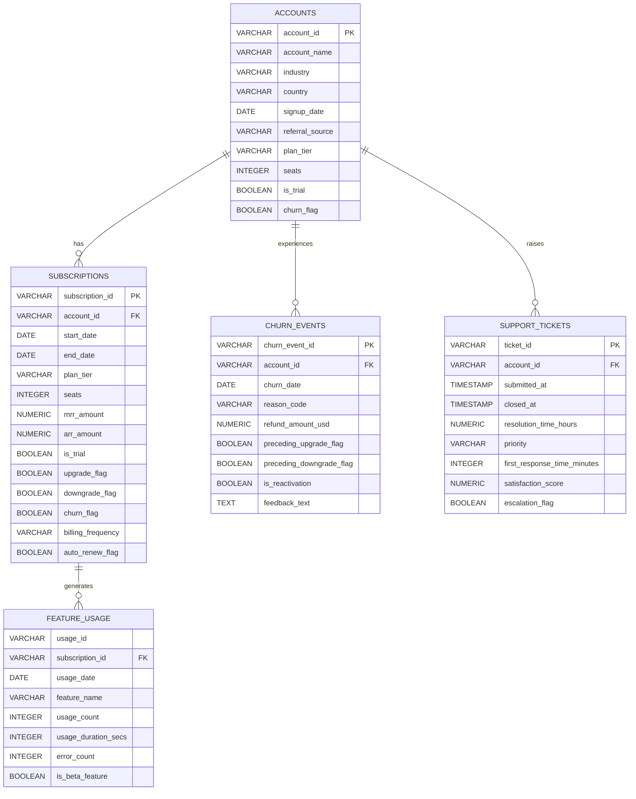

# Database Schema — SaaS Revenue & Subscription Analytics

## 1. Overview

This document defines the proposed relational schema for the five RavenStack source datasets. The schema is based on inspected source columns and validated relationships.

The five entities are:
1. Accounts
2. Subscriptions
3. Churn Events
4. Feature Usage
5. Support Tickets

**Implementation status:** This is a final schema specification for review. It does not claim that all five tables have been deployed in a shared PostgreSQL database.

## 2. Entity Relationship Diagram

## 3. Primary and Foreign Keys

| Table | Primary key | Foreign key |
|---|---|---|
| accounts | account_id | None |
| subscriptions | subscription_id | account_id |
| churn_events | churn_event_id | account_id |
| feature_usage | Not confirmed | subscription_id |
| support_tickets | ticket_id | account_id |

### Feature Usage key decision

The source contains 25,000 records but only 24,979 distinct usage IDs. There are 21 repeated IDs, involving 42 rows.

Therefore:
- Do not enforce usage_id as a primary key.
- Preserve all source records.
- Investigate a composite key before deployment.
- Alternatively, introduce a generated surrogate usage record ID during database implementation.

## 4. Relationships and Validation Evidence

| Relationship | Cardinality | Validation |
|---|---|---|
| Accounts → Subscriptions | One-to-many | 5,000/5,000 references matched |
| Accounts → Churn Events | One-to-many | 600/600 references matched |
| Accounts → Support Tickets | One-to-many | 2,000/2,000 references matched |
| Subscriptions → Feature Usage | One-to-many | 25,000/25,000 references matched |

All four foreign-key relationship checks passed against the raw datasets.

## 5. Recommended PostgreSQL Data Types

| Source type | Recommended PostgreSQL type |
|---|---|
| Identifier / categorical text | VARCHAR |
| Descriptive feedback | TEXT |
| Date | DATE |
| Timestamp | TIMESTAMP |
| Monetary amount | NUMERIC(14,2) |
| Count / seats / duration | INTEGER |
| Flags | BOOLEAN |
| Satisfaction score | NUMERIC(3,1) |

## 6. Recommended Indexes

- subscriptions(account_id)
- churn_events(account_id)
- churn_events(churn_date)
- feature_usage(subscription_id)
- feature_usage(usage_date)
- support_tickets(account_id)
- support_tickets(submitted_at)
- support_tickets(priority)

## 7. Data Constraints and Caveats

- IDs used as primary keys must be NOT NULL and unique.
- Foreign-key references must point to existing parent records.
- MRR, ARR and refund amounts should use numeric types.
- Satisfaction scores should be nullable and constrained to the observed valid scale of 1–5 where applicable.
- Subscription end_date must remain nullable because 4,514 source rows have no end date.
- Feedback text must remain nullable because 148 churn events have no feedback.
- Do not assume missing subscription end dates mean active subscriptions without validating lifecycle rules.
- Do not impose uniqueness on feature_usage.usage_id until duplicate investigation is complete.
- Preserve raw datasets and keep transformations in separate interim datasets.

## 8. Conclusion

The proposed schema represents all five source datasets and their four validated relationships. Four primary keys are confirmed by uniqueness checks. Feature Usage requires a separate key-resolution decision before database constraints are finalized.
