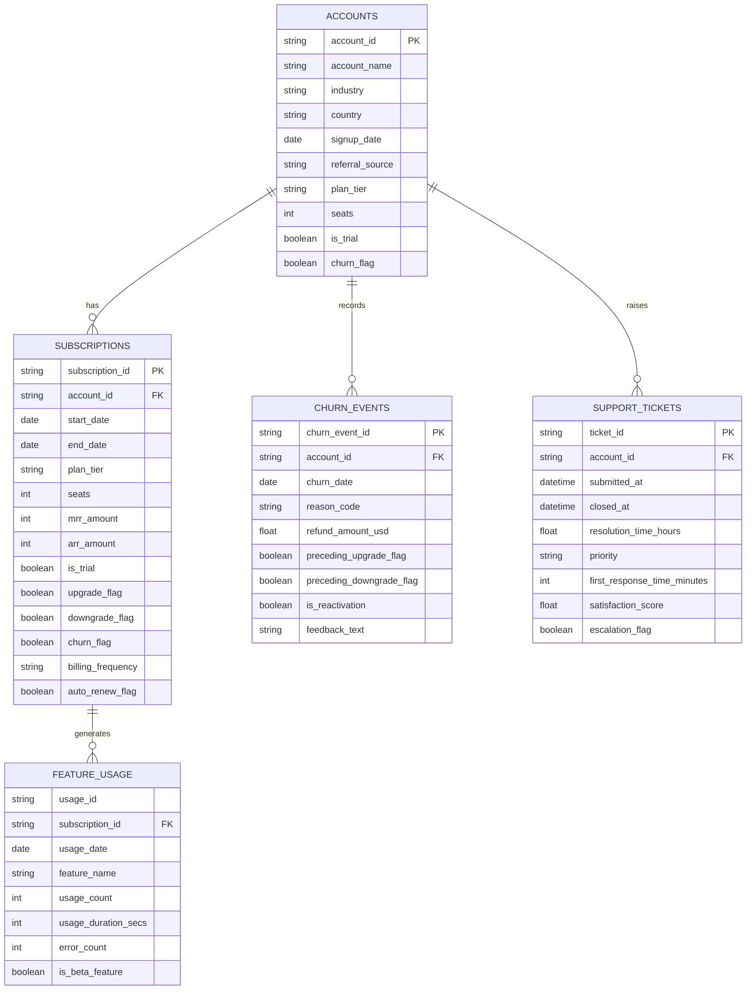

# RavenStack SaaS Analytics — Database Schema Draft

## 1. Project Overview

This document describes the proposed relational database structure for the RavenStack SaaS Revenue and Subscription Analytics project.

The database design is based on the five supplied CSV datasets. The source data is synthetic and must credit River @ Rivalytics.

## 2. Source Tables

| Table | Source File | Rows |
|---|---|---:|
| accounts | ravenstack_accounts.csv | 500 |
| subscriptions | ravenstack_subscriptions.csv | 5,000 |
| churn_events | ravenstack_churn_events.csv | 600 |
| feature_usage | ravenstack_feature_usage.csv | 25,000 |
| support_tickets | ravenstack_support_tickets.csv | 2,000 |

Total source records: 33,100.

## 3. Proposed Primary Keys

| Table | Candidate Primary Key | Validation |
|---|---|---|
| accounts | account_id | Confirmed unique |
| subscriptions | subscription_id | Confirmed unique |
| churn_events | churn_event_id | Confirmed unique |
| feature_usage | usage_id | NOT unique; 21 duplicated IDs |
| support_tickets | ticket_id | Confirmed unique |

A surrogate primary key should be considered for feature_usage. A composite key must only be selected after uniqueness testing.

## 4. Proposed Foreign Keys

| Child Table | Foreign Key | Parent Table | Parent Key |
|---|---|---|---|
| subscriptions | account_id | accounts | account_id |
| churn_events | account_id | accounts | account_id |
| support_tickets | account_id | accounts | account_id |
| feature_usage | subscription_id | subscriptions | subscription_id |

All four relationships passed the initial Python referential-integrity checks.

## 5. Entity Relationship Diagram

Note: The feature_usage table does not yet have a confirmed primary key.

## 6. Relationship Cardinality

### Accounts to Subscriptions
- One account can have multiple subscriptions.
- 5,000 subscription records matched 500 accounts.
- Observed subscriptions per account: 2–19.

### Accounts to Churn Events
- One account can have multiple churn events.
- 600 events matched 352 distinct accounts.
- Reactivation events must be considered during churn analysis.

### Accounts to Support Tickets
- One account can raise multiple support tickets.
- 2,000 tickets matched 492 distinct accounts.

### Subscriptions to Feature Usage
- One subscription can generate multiple feature usage records.
- All 25,000 records matched valid subscriptions.
- Feature usage IDs contain 21 duplicate values.

## 7. Important Schema Limitations

1. There is no separate plans.csv or plans table.
2. There are no invoices or payments tables.
3. plan_tier is available in accounts and subscriptions.
4. usage_id is not currently suitable as a unique primary key.
5. Nullable end_date values must not automatically be treated as errors.
6. Churn events can contain multiple events for one account.

## 8. Database Design Recommendations

- Use PostgreSQL for relational storage.
- Preserve source identifiers as text.
- Use DATE for date-only fields and TIMESTAMP for datetime fields.
- Use BOOLEAN for flags.
- Use appropriate numeric types for revenue and duration fields.
- Define foreign keys after confirming the final schema.
- Consider indexes on account_id and subscription_id.
- Preserve raw source data unchanged.
- Maintain separate raw and cleaned datasets.

## 9. Validation Status

The four proposed foreign-key relationships passed the initial Python validation.

The five candidate primary keys were inspected. Four are unique; feature_usage requires further investigation.

This is a draft schema. Final PostgreSQL DDL will be prepared after the team's schema review.
