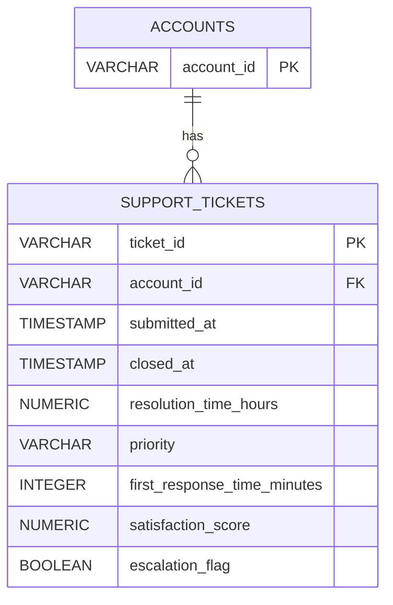

# Support Tickets Entity Relationship Diagram

## Relationship Explanation

- One account can have zero or many support tickets.
- Each support ticket belongs to one account.
- `ticket_id` is the proposed primary key.
- `account_id` is the proposed foreign key referencing `accounts.account_id`.
