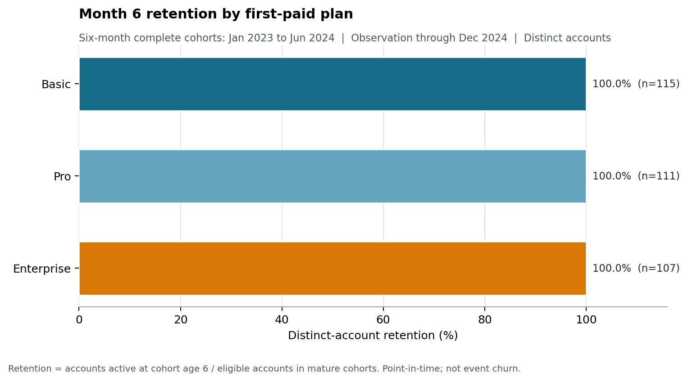
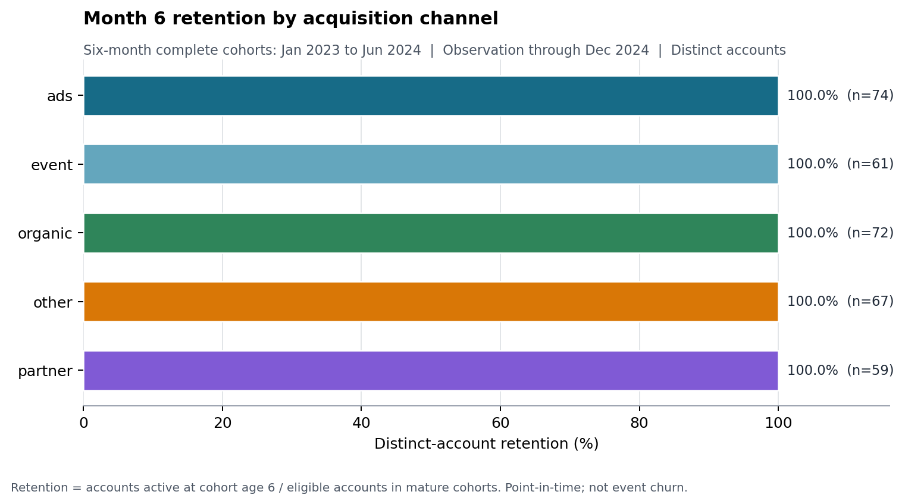

# Week 3 — Plan, channel and country segment analysis

**Observation cutoff:** December 2024

**Comparison window:** Month 6 after cohort entry, using cohorts from January 2023 through June 2024 only

**Unit:** Distinct eligible `account_id`

## Executive summary

Month 6 retention is 100% in every plan and acquisition-channel group in the mature sample (333 accounts across 18 cohort months). This is a point-in-time result under the provisional month-end activity rule, not evidence that no account churned during the six-month period.

One account had a non-reactivation churn event in a follow-up month, was active at the preceding month-end, and had no eligible paid subscription at that event month's close. It was active again by Month 6. This is the only provisional event/state churn signal in the mature sample (1 of 331 Month 0 active accounts). Event and end-date semantics remain unapproved, so do not treat this signal as a final churn KPI.

Country is fully populated. Five countries have at least 20 mature accounts; Canada and France are flagged as sparse under the report's 20-account review threshold. Results are descriptive and do not support causal claims.

## Population and method

- The source contains 500 unique accounts, all assigned to a paid cohort. First-paid plan is taken from each account's earliest qualifying non-trial subscription with positive MRR, matching the cohort-plan definition.
- The last observed activity month is December 2024. A six-month follow-up is complete for cohort months through June 2024, inclusive: 18 cohort months and 333 distinct accounts.
- Month 6 retention is distinct accounts active at cohort age 6 divided by all eligible accounts in those mature cohorts. All segments use this same window and denominator rule.
- The endpoint inactivity rate is `1 - Month 6 retention`; it is a point-in-time non-retention measure, not cumulative event churn.
- A separate **provisional event/state churn signal** counts each distinct Month 0-active account at most once if, in a follow-up month 1–6, it had a non-reactivation churn event, was active at the preceding month-end, and had no eligible paid subscription at that month's closing snapshot. Its denominator is distinct accounts active at Month 0, not all cohort entrants.
- Account grain is preserved despite multiple subscriptions. Account referral source and country come from `accounts`; plan attribution is first paid plan. No account is counted multiple times within a segment.

## Plan-tier comparison

| First-paid plan | Full eligible accounts | Mature Month 6 cohort | Month 6 active / n | Month 6 retention | Event/state churn / Month 0 active |
|---|---:|---:|---:|---:|---:|
| Basic | 164 | 115 | 115 / 115 | 100.0% | 0 / 115 |
| Enterprise | 172 | 107 | 107 / 107 | 100.0% | 1 / 106 (0.94%) |
| Pro | 164 | 111 | 111 / 111 | 100.0% | 0 / 110 |

The one Enterprise event/state signal is active again by Month 6. Therefore endpoint inactivity is zero in every plan group even though a temporary event/state loss occurred during follow-up.

## Acquisition-channel comparison

`accounts.referral_source` is populated for all 500 accounts and all 333 mature cohort accounts. The observed `other` value is retained as a real source category. Missing values and the literal value `unknown` are shown separately below; neither occurs in this source.

| Referral source | Full accounts | Mature Month 6 cohort | Month 6 active / n | Month 6 retention | Event/state churn / Month 0 active |
|---|---:|---:|---:|---:|---:|
| ads | 98 | 74 | 74 / 74 | 100.0% | 0 / 73 |
| event | 96 | 61 | 61 / 61 | 100.0% | 0 / 61 |
| organic | 114 | 72 | 72 / 72 | 100.0% | 1 / 72 (1.39%) |
| other | 103 | 67 | 67 / 67 | 100.0% | 0 / 67 |
| partner | 89 | 59 | 59 / 59 | 100.0% | 0 / 58 |
| **Missing** | **0** | **0** | — | — | 0 / 0 |
| **Unknown (literal)** | **0** | **0** | — | — | 0 / 0 |
| **Total** | **500** | **333** | **333 / 333** | **100.0%** | **1 / 331** |

The single event/state signal is in the organic group. With only one such account overall, this does not establish a channel difference.

## Country coverage and comparison

Country coverage is 500/500 overall (100%) and 333/333 in the mature sample (100%). The table retains every observed country; groups with fewer than 20 mature accounts are flagged as sparse. The threshold is a review flag, not a statistical guarantee.

| Country | Full accounts | Mature Month 6 cohort | Month 6 active / n | Month 6 retention | Event/state churn / Month 0 active | Review |
|---|---:|---:|---:|---:|---:|---|
| AU | 32 | 24 | 24 / 24 | 100.0% | 0 / 23 | Descriptive |
| CA | 23 | 16 | 16 / 16 | 100.0% | 0 / 16 | Sparse |
| DE | 25 | 22 | 22 / 22 | 100.0% | 1 / 22 (4.55%) | Descriptive |
| FR | 22 | 15 | 15 / 15 | 100.0% | 0 / 15 | Sparse |
| IN | 49 | 35 | 35 / 35 | 100.0% | 0 / 35 | Descriptive |
| UK | 58 | 36 | 36 / 36 | 100.0% | 0 / 36 | Descriptive |
| US | 291 | 185 | 185 / 185 | 100.0% | 0 / 184 | Descriptive |
| **Missing** | **0** | **0** | — | — | 0 / 0 | — |
| **Unknown (literal)** | **0** | **0** | — | — | 0 / 0 | — |
| **Total** | **500** | **333** | **333 / 333** | **100.0%** | **1 / 331** | — |

Country-level retention is shown as a descriptive comparison only. The one event/state signal is in Germany; a single account and small country groups do not support country ranking or causal interpretation.

## Churn interpretation and limitations

- The source has 600 churn-event rows for 352 distinct accounts. Repeated events are deduplicated to distinct accounts for the event/state signal; `is_reactivation = TRUE` events are not counted as churn events.
- The Month 6 point-in-time retention and the provisional event/state signal answer different questions. An account can have a temporary churn event and inactive close, then return before Month 6; that occurred once here.
- The churn-event table links to accounts, not subscription IDs. Event semantics and the end-date boundary are not confirmed, and multiple subscriptions can remain active after one subscription ends. The event/state result is consequently provisional, not an approved customer churn rate.
- The Month 6 retention estimates are uniformly 100% in this source and this window. Report the numerators and denominators; do not generalize to later cohorts or claim that plan, channel, or country causes retention.
- The charts show the Month 6 point-in-time retention comparison only. Churn-event signals and their distinct Month 0 risk denominators are reported separately above.
